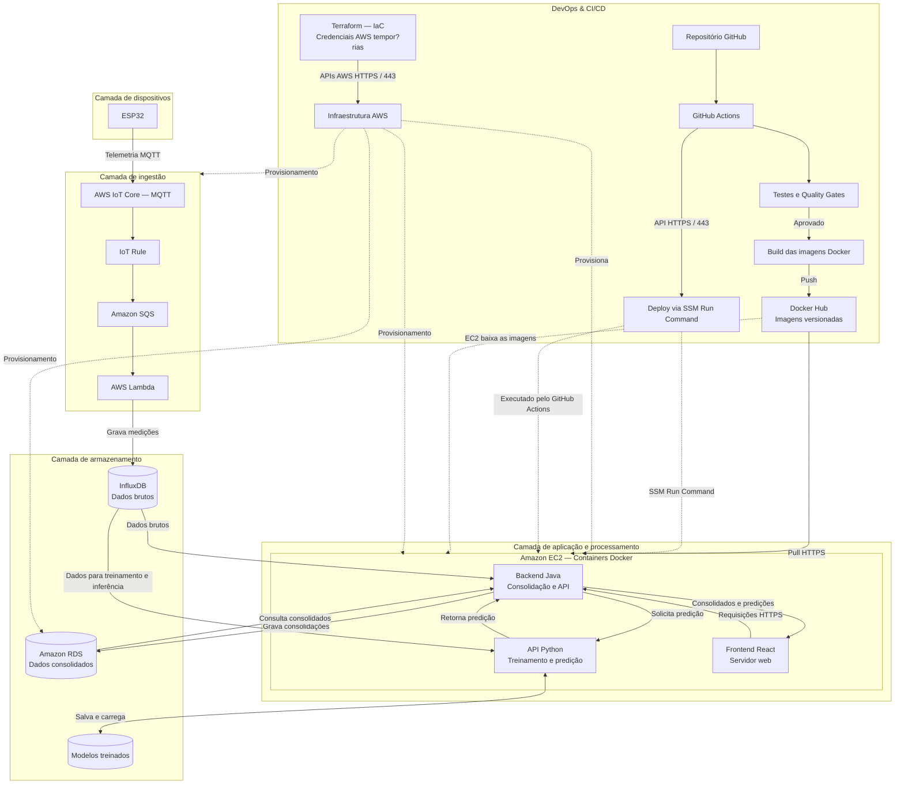

# Factory Hub — Ecossistema Integrado de Software Industrial (Indústria 4.0)

> **Projeto Integrador Multidisciplinar** conectando as disciplinas de **Automação Industrial**, **Ciência de Dados**, **Computação em Nuvem** e **Integração e Entrega Contínua (DevOps)**, dimensionado para o ambiente **AWS Academy Learner Lab**.

> **Estado atual da integracao:** frontend -> API Java -> PostgreSQL/RDS e InfluxDB; Java usa PostgreSQL para catálogo de máquinas, snapshots OEE e alertas, e consulta telemetria bruta no InfluxDB. Flask treina a Random Forest com o histórico do InfluxDB. Os snapshots OEE iniciais são didáticos; o cálculo a partir de turnos reais ainda precisa ser implementado. A infraestrutura AWS e o deploy SSM já foram provisionados e executados; o IoT Core aguarda certificado/política do dispositivo ESP32.

---

## 1. Visão Geral do Projeto

O **Factory Hub** é uma plataforma distribuída de manufatura inteligente inspirada no conceito de **Fábrica Virtual / Célula Fabril Smart N1**. A arquitetura conecta sinais da borda simulada, dados operacionais, predição de condição de máquinas e visualização gerencial do **OEE (Overall Equipment Effectiveness)**. No protótipo atual, a API Flask treina uma Random Forest com dados sintéticos para exercitar esse fluxo.

### Alinhamento com as Unidades Curriculares

```
┌──────────────────────────────────────────────────────────────────────────────────┐
│                             FACTORY HUB ECOSYSTEM                                │
├────────────────────────┬────────────────────────┬────────────────────────────────┤
│  Automação Industrial  │    Ciência de Dados    │       Computação em Nuvem      │
│  • ESP32 (Wokwi)       │  • Metodologia CRISP-DM│  • AWS Academy (perfis IAM compativeis)       │
│  • MQTT & Node-RED     │  • CRISP-DM + Random Forest │  • AWS IoT Core + Amazon SQS   │
│  • Sinais OT (Sensores)│  • API Flask Predição  │  • EC2 + Docker + RDS / IaC TF │
├────────────────────────┴────────────────────────┴────────────────────────────────┤
│                    Integração e Entrega Contínua (DevOps)                        │
│  • GitFlow + Conventional Commits + SemVer                                       │
│  • Pirâmide de Testes (Unitários, Integração e E2E)                              │
│  • GitHub Actions CI/CD + Docker Hub + Deploy Contínuo na EC2                    │
└──────────────────────────────────────────────────────────────────────────────────┘
```

---

## 2. Arquitetura da Solução



---

## 3. Componentes e Responsabilidades

| Componente | Tecnologia | Disciplina | Responsabilidade |
|---|---|---|---|
| **Edge Simulado** | ESP32 (Wokwi C++) | Automação Industrial | Coletar/gerar telemetria contínua de sensores (temperatura, vibração, rotação, peças produzidas, peças defeituosas e estado operacional) e publicar via MQTT. |
| **Painel Local / Monitor** | Node-RED | Automação Industrial | Validar os fluxos MQTT antes do envio à nuvem, simular falhas intencionais e atuar como ferramenta de observabilidade OT. |
| **Ingestão IoT** | AWS IoT Core + Topic Rules | Nuvem / Automação | Broker gerenciado seguro para recebimento de telemetria e redirecionamento declarativo de pacotes via regra de tópico para a fila SQS. |
| **Buffer de Ingestão** | Amazon SQS (com DLQ) | Computação em Nuvem | Absorver picos de tráfego de múltiplos dispositivos e desacoplar a ingestão do processamento pela função Lambda. |
| **Consumidor da fila** | AWS Lambda | Nuvem / Automação | Consumir mensagens da SQS por event source mapping, validar telemetria e gravar medições brutas no InfluxDB. |
| **Banco Temporal** | TimescaleDB / InfluxDB (Container) | Nuvem / Dados | Armazenamento de alta performance para séries temporais brutas, ideal para consultas de janelas deslizantes da rede neural. |
| **Banco Relacional** | Amazon RDS PostgreSQL (`db.t3.micro`) | Computação em Nuvem | Armazenamento persistente de cadastros (máquinas, linhas de produção, operadores), apontamento de turnos e logs consolidados de OEE. |
| **API de Predição** | Python 3.12 + Flask + scikit-learn | Ciência de Dados | Consultar séries históricas no InfluxDB para treinar e servir uma Random Forest; aceitar dados sintéticos quando executado sem a integração local. |
| **Backend de Negócio** | Java 17/21 + Spring Boot 3 | Computação em Nuvem | Ler séries brutas do InfluxDB, consolidar dados e calcular Disponibilidade, Performance e Qualidade (OEE) no RDS, e intermediar previsões da IA. |
| **Interface do Usuário** | React 18 + Vite + TailwindCSS | DevOps / Frontend | Exibir gráficos em tempo real de telemetria, painéis de OEE por máquina/turno e alertas preditivos de manutenção. |
| **Infraestrutura como Código** | Terraform + GitHub Actions + S3 | Computação em Nuvem | Validar, planejar e aplicar a topologia AWS por workflow manual, com credenciais em GitHub Secrets e state remoto versionado no S3. |
| **Esteira de CI/CD** | GitHub Actions + Docker Hub + SSM | DevOps | Construir e publicar imagens versionadas, atualizar a EC2 por SSM e executar Terraform manualmente com state remoto no S3. |

---

## 4. Diretrizes Críticas para AWS Academy Learner Lab

> **Provisionamento:** Terraform executa em `.github/workflows/terraform.yml` quando acionado manualmente. Credenciais AWS são lidas dos GitHub Secrets; state remoto usa o bucket S3 indicado por `TF_STATE_BUCKET`. Antes de rodar, crie o bucket com bloqueio público, versionamento e criptografia, e configure as Repository variables IAM listadas em [`terraform/README.md`](terraform/README.md). O deploy da aplicação continua no workflow SSM separado.

---

## 5. Contratos de Dados e Interfaces

### 5.1. Payload MQTT (ESP32 -> AWS IoT Core)
**Tópico:** `industria/smartn1/telemetria`
```json
{
  "device_id": "esp32-torno-01",
  "machine_type": "USINAGEM",
  "timestamp": 1794144000,
  "temperatura": 72.8,
  "vibracao": 2.45,
  "rpm": 3480,
  "status": "OPERATIONAL",
  "pecas_produzidas": 15,
  "pecas_defeito": 1
}
```
`timestamp` deve ser Unix Epoch em segundos UTC obtido por NTP; não use `millis()/1000`. A conexão com AWS IoT Core usa o endpoint de dados da conta, MQTTS na porta 8883, certificado/chave do dispositivo e Amazon Root CA 1. Veja o passo a passo em [`docs/01_automacao_industrial.md`](docs/01_automacao_industrial.md#32-tópico-implantado-no-aws-iot-core).

Para montar o circuito Wokwi com três potenciômetros, configurar certificados e executar o firmware completo, consulte o [guia ESP32 + Wokwi](docs/07_guia_esp32_wokwi.md).

### 5.2. Endpoint da API Python Flask (Predição)
**Rota:** `POST /predict`
- **Request:**
  ```json
  {
    "device_id": "esp32-torno-01",
    "temperatura": 72.8,
    "vibracao": 2.45,
    "rpm": 3480
  }
  ```
- **Response:**
  ```json
  {
    "device_id": "esp32-torno-01",
    "status_previsto": "RISCO_ANOMALIA",
    "probabilidade_falha": 0.87,
    "recomendacao": "Reduzir carga e inspecionar rolamento principal",
    "modelo_versao": "mlp-v1.2"
  }
  ```

### 5.3. Endpoints da API Java (Spring Boot)
- `GET /api/v1/maquinas`: Lista todas as máquinas cadastradas e último status.
- `GET /api/v1/telemetria/{deviceId}/recente`: Últimas medições brutas para plotagem de gráficos ao vivo.
- `GET /api/v1/indicadores/{deviceId}/oee?periodo=hoje`: Retorna Disponibilidade, Performance, Qualidade e OEE consolidado.
- `GET /api/v1/alertas`: Lista alertas de anomalias gerados pela Rede Neural.

---

## 6. Estrutura do Repositório Recomendada

```text
Factory Hub/
├── README.md                      # Documento principal do ecossistema
├── plano_implementacao.md         # Roteiro passo a passo de desenvolvimento
│
├── firmware/                      # Automação Industrial
│   ├── esp32_wokwi/
│   │   ├── diagram.json           # Esquema eletrônico no Wokwi
│   │   └── sketch.ino             # Código C++ com cliente MQTT / TLS
│   └── nodered/
│       └── flows.json             # Fluxo exportado do Node-RED para injeção de falhas
│
├── terraform/                     # Computação em Nuvem (IaC AWS Academy)
│   ├── backend.tf                 # Backend remoto S3
│   ├── main.tf                    # Dados de região, AMI e credenciais geradas
│   ├── network.tf                 # VPC, sub-redes, rotas e Internet Gateway
│   ├── compute.tf                 # EC2 sem SSH, bootstrap Docker e SSM
│   ├── storage.tf                 # RDS PostgreSQL privado
│   ├── ingestion.tf               # IoT Rule, SQS, Lambda e event source mapping
│   ├── security_groups.tf         # Regras web, InfluxDB, Lambda e RDS
│   ├── README.md                  # Backend remoto, variáveis e workflow de provisionamento
│   └── terraform.tfvars.example   # Perfis IAM preexistentes e Docker Hub
│
├── ml-service/                    # Ciência de Dados (Python Flask + ML)
│   ├── factoryhub_ml/             # API, fonte de treino mockada e pipeline Random Forest
│   ├── requirements.txt           # Flask, Gunicorn e scikit-learn
│   ├── README.md                  # Contrato, fonte mockada e integração planejada
│   └── Dockerfile                 # Serviço Flask containerizado
│
├── backend-java/                  # Backend de Negócio & API Java
│   ├── pom.xml                    # Maven com dependências Spring Boot & AWS SDK
│   ├── src/
│   │   ├── main/java/...          # Controllers, Services, integracoes e entidades
│   │   └── test/java/...          # Testes unitários e de integração (JUnit 5, Mockito)
│   └── Dockerfile                 # Imagem multi-stage Eclipse Temurin
│
├── frontend-react/                # Dashboard de Visualização (React)
│   ├── package.json
│   ├── src/
│   │   ├── components/            # Cards de OEE, Gráficos Recharts, Tabela de Alertas
│   │   └── services/              # Cliente Axios para a API Java
│   └── Dockerfile                 # Build Vite + Nginx Alpine
│
├── docker-compose.yml             # Orquestração local
├── docker-compose.cloud.yml       # Compose de produção na EC2
└── .github/
    └── workflows/
        ├── terraform.yml          # Provisionamento manual com state S3
        ├── publish-dockerhub.yml  # Publicação manual das imagens no Docker Hub
        └── deploy-ssm.yml         # Deploy manual por SSM das imagens já publicadas
```

---

## 7. Como Iniciar a Execução

Consulte o documento detalhado **[plano_implementacao.md](./plano_implementacao.md)** para o passo a passo de cada uma das 6 fases do projeto.

