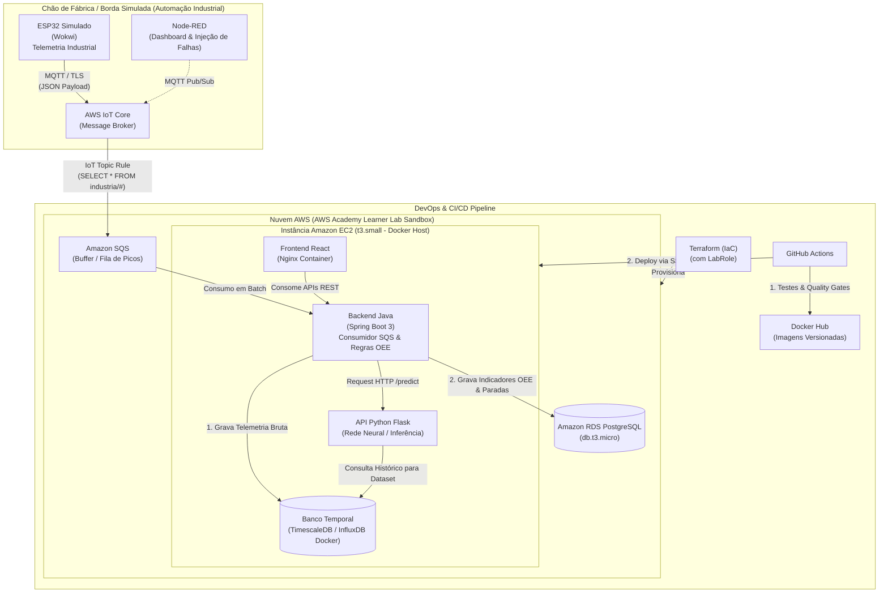

# Factory Hub — Ecossistema Integrado de Software Industrial (Indústria 4.0)

> **Projeto Integrador Multidisciplinar** conectando as disciplinas de **Automação Industrial**, **Ciência de Dados**, **Computação em Nuvem** e **Integração e Entrega Contínua (DevOps)**, dimensionado para o ambiente **AWS Academy Learner Lab**.

> **Estado atual da integração:** o backend Java Spring Boot foi adicionado e já atende o frontend. Os dados de máquinas, OEE, alertas, telemetria, predição e status das dependências usam adapters mockados por padrão. Consulte [backend-java/README.md](./backend-java/README.md) para executar e ver a origem prevista de cada conjunto de dados.

---

## 1. Visão Geral do Projeto

O **Factory Hub** é uma plataforma distribuída de manufatura inteligente inspirada no conceito de **Fábrica Virtual / Célula Fabril Smart N1**. O sistema implementa uma esteira completa de engenharia de software industrial: desde a geração de sinais na borda simulada até a predição de anomalias por Redes Neurais e visualização gerencial do **OEE (Overall Equipment Effectiveness)**.

### Alinhamento com as Unidades Curriculares

```
┌──────────────────────────────────────────────────────────────────────────────────┐
│                             FACTORY HUB ECOSYSTEM                                │
├────────────────────────┬────────────────────────┬────────────────────────────────┤
│  Automação Industrial  │    Ciência de Dados    │       Computação em Nuvem      │
│  • ESP32 (Wokwi)       │  • Metodologia CRISP-DM│  • AWS Academy (LabRole)       │
│  • MQTT & Node-RED     │  • Redes Neurais (MLP) │  • AWS IoT Core + Amazon SQS   │
│  • Sinais OT (Sensores)│  • API Flask Predição  │  • EC2 + Docker + RDS / IaC TF │
├────────────────────────┴────────────────────────┴────────────────────────────────┤
│                    Integração e Entrega Contínua (DevOps)                        │
│  • GitFlow + Conventional Commits + SemVer                                       │
│  • Pirâmide de Testes (Unitários, Integração e E2E)                              │
│  • GitHub Actions CI/CD + Docker Hub + Deploy Contínuo na EC2                    │
└──────────────────────────────────────────────────────────────────────────────────┘
```

---

## 2. Arquitetura da Solução



---

## 3. Componentes e Responsabilidades

| Componente | Tecnologia | Disciplina | Responsabilidade |
|---|---|---|---|
| **Edge Simulado** | ESP32 (Wokwi C++) | Automação Industrial | Coletar/gerar telemetria contínua de sensores (temperatura, vibração, rotação, peças produzidas, peças defeituosas e estado operacional) e publicar via MQTT. |
| **Painel Local / Monitor** | Node-RED | Automação Industrial | Validar os fluxos MQTT antes do envio à nuvem, simular falhas intencionais e atuar como ferramenta de observabilidade OT. |
| **Ingestão IoT** | AWS IoT Core + Topic Rules | Nuvem / Automação | Broker gerenciado seguro para recebimento de telemetria e redirecionamento declarativo de pacotes via regra de tópico para a fila SQS. |
| **Buffer de Ingestão** | Amazon SQS (com DLQ) | Computação em Nuvem | Absorver picos de tráfego de múltiplos dispositivos, garantindo que o backend processe as mensagens de forma assíncrona sem perda de dados. |
| **Banco Temporal** | TimescaleDB / InfluxDB (Container) | Nuvem / Dados | Armazenamento de alta performance para séries temporais brutas, ideal para consultas de janelas deslizantes da rede neural. |
| **Banco Relacional** | Amazon RDS PostgreSQL (`db.t3.micro`) | Computação em Nuvem | Armazenamento persistente de cadastros (máquinas, linhas de produção, operadores), apontamento de turnos e logs consolidados de OEE. |
| **API de Predição** | Python 3.11 + Flask + PyTorch/Keras | Ciência de Dados | Servir a Rede Neural (MLP ou LSTM) para diagnóstico em tempo real de anomalias mecânicas e probabilidade de falha operacional. |
| **Backend de Negócio** | Java 17/21 + Spring Boot 3 | Computação em Nuvem | Consumir da fila SQS, persistir nos bancos, calcular fórmulas de Disponibilidade, Performance e Qualidade (OEE) e intermediar previsões da IA. |
| **Interface do Usuário** | React 18 + Vite + TailwindCSS | DevOps / Frontend | Exibir gráficos em tempo real de telemetria, painéis de OEE por máquina/turno e alertas preditivos de manutenção. |
| **Infraestrutura como Código** | Terraform | Computação em Nuvem | Provisionar toda a topologia AWS dentro das restrições do AWS Academy com um comando reproduzível. |
| **Esteira de CI/CD** | GitHub Actions + Docker Hub | DevOps | Orquestrar testes automatizados (unitários/integração), construir imagens Docker versionadas, publicar no Docker Hub e atualizar a EC2. |

---

## 4. Diretrizes Críticas para AWS Academy Learner Lab

> [!WARNING]
> **Limitações do AWS Academy Learner Lab:**
> 1. **Sem criação de IAM Roles (`iam:CreateRole` desabilitado):** Todos os serviços (EC2, etc.) devem utilizar a role já existente:
>    ```text
>    arn:aws:iam::<ACCOUNT_ID>:role/LabRole
>    ```
>    ou o perfil de instância `LabInstanceProfile`.
> 2. **Orçamento Fixo ($50 a $100):** É mandatório evitar serviços de alta tarifação contínua como NAT Gateways gerenciados (~$32/mês), AWS Timestream (queries tarifadas) e Application Load Balancers.
> 3. **Solução Econômica Adotada no Factory Hub:**
>    - **Rede Simplificada:** Sub-rede pública na VPC com Security Group restritivo direto na EC2 (dispensa NAT Gateway pago).
>    - **Banco Temporal Conteinerizado:** Rodar o **TimescaleDB** ou **InfluxDB** como container Docker na mesma EC2 do backend (custo adicional: $0).
>    - **Instância Única:** Utilizar uma instância `t3.small` (2 vCPU, 2GB RAM) suficiente para rodar os 4 containers da aplicação via Docker Compose.
>    - **RDS no Free Tier:** Utilizar `db.t3.micro` Single-AZ com PostgreSQL.

---

## 5. Contratos de Dados e Interfaces

### 5.1. Payload MQTT (ESP32 -> AWS IoT Core)
**Tópico:** `industria/smartn1/telemetria`
```json
{
  "device_id": "esp32-torno-01",
  "timestamp": 1715428800,
  "temperatura": 72.8,
  "vibracao": 2.45,
  "rpm": 3480,
  "status": "OPERATIONAL",
  "pecas_produzidas": 15,
  "pecas_defeito": 1
}
```

### 5.2. Endpoint da API Python Flask (Predição)
**Rota:** `POST /predict`
- **Request:**
  ```json
  {
    "device_id": "esp32-torno-01",
    "temperatura": 72.8,
    "vibracao": 2.45,
    "rpm": 3480
  }
  ```
- **Response:**
  ```json
  {
    "device_id": "esp32-torno-01",
    "status_previsto": "RISCO_ANOMALIA",
    "probabilidade_falha": 0.87,
    "recomendacao": "Reduzir carga e inspecionar rolamento principal",
    "modelo_versao": "mlp-v1.2"
  }
  ```

### 5.3. Endpoints da API Java (Spring Boot)
- `GET /api/v1/maquinas`: Lista todas as máquinas cadastradas e último status.
- `GET /api/v1/telemetria/{deviceId}/recente`: Últimas medições brutas para plotagem de gráficos ao vivo.
- `GET /api/v1/indicadores/{deviceId}/oee?periodo=hoje`: Retorna Disponibilidade, Performance, Qualidade e OEE consolidado.
- `GET /api/v1/alertas`: Lista alertas de anomalias gerados pela Rede Neural.

---

## 6. Estrutura do Repositório Recomendada

```text
Factory Hub/
├── README.md                      # Documento principal do ecossistema
├── plano_implementacao.md         # Roteiro passo a passo de desenvolvimento
│
├── firmware/                      # Automação Industrial
│   ├── esp32_wokwi/
│   │   ├── diagram.json           # Esquema eletrônico no Wokwi
│   │   └── sketch.ino             # Código C++ com cliente MQTT / TLS
│   └── nodered/
│       └── flows.json             # Fluxo exportado do Node-RED para injeção de falhas
│
├── terraform/                     # Computação em Nuvem (IaC AWS Academy)
│   ├── main.tf                    # Declaração dos recursos (VPC, SQS, RDS, EC2)
│   ├── variables.tf               # Variáveis parametrizadas
│   ├── outputs.tf                 # Endpoints gerados (IP EC2, Host RDS, URL SQS)
│   └── terraform.tfvars.example   # Exemplo de variáveis (LabRole ARN)
│
├── ml-service/                    # Ciência de Dados (Python Flask + ML)
│   ├── app.py                     # API Flask com endpoints /predict e /health
│   ├── train.py                   # Script de treinamento do modelo de Rede Neural
│   ├── model/                     # Pesos do modelo treinado (.h5 / .pt / .joblib)
│   ├── tests/                     # Testes unitários com pytest
│   ├── requirements.txt           # Dependências (Flask, PyTorch/Keras, Pandas)
│   └── Dockerfile                 # Imagem multi-stage Python
│
├── backend-java/                  # Backend de Negócio & Ingestor SQS (Java)
│   ├── pom.xml                    # Maven com dependências Spring Boot & AWS SDK
│   ├── src/
│   │   ├── main/java/...          # Controllers, Services, Listeners SQS, Entities
│   │   └── test/java/...          # Testes unitários e de integração (JUnit 5, Mockito)
│   └── Dockerfile                 # Imagem multi-stage Eclipse Temurin
│
├── frontend-react/                # Dashboard de Visualização (React)
│   ├── package.json
│   ├── src/
│   │   ├── components/            # Cards de OEE, Gráficos Recharts, Tabela de Alertas
│   │   └── services/              # Cliente Axios para a API Java
│   └── Dockerfile                 # Build Vite + Nginx Alpine
│
├── docker-compose.yml             # Orquestração local e de produção na EC2
└── .github/
    └── workflows/
        └── ci-cd.yml              # Pipeline GitHub Actions (Testes -> Build -> Docker Hub -> EC2)
```

---

## 7. Como Iniciar a Execução

Consulte o documento detalhado **[plano_implementacao.md](./plano_implementacao.md)** para o passo a passo de cada uma das 6 fases do projeto.

