# 🎨 Planejamento do Frontend — Factory Hub (Portal Interativo & Apostila Viva)

> **Conceito Central:** O frontend do Factory Hub é projetado não apenas como um painel de telemetria convencional, mas como um **Portal Educacional Interativo e Apostila Viva**, materializando as 4 disciplinas do curso (Automação Industrial, Ciência de Dados, Computação em Nuvem e DevOps).

---

## 🎯 1. Filosofia de Design e UX

Cada tela do sistema segue a filosofia **Dual View (Aprender & Operar)**:
1. **Visão Teórica / Didática ("Apostila Viva"):** Apresenta os conceitos ensinados em sala de aula (fórmulas matemáticas em LaTeX, diagramas de arquitetura, referências às semanas de aula e metodologia CRISP-DM/ISA-95/CALMS).
2. **Visão Prática / Laboratório Interativo ("Playground"):** Componentes operacionais com dados reais ou simulados, sliders para injeção de parâmetros, gráficos em tempo real e teste direto de hipóteses.

```
┌────────────────────────────────────────────────────────────────────────┐
│                        TELA DO MÓDULO DIDÁTICO                         │
├───────────────────────────────────┬────────────────────────────────────┤
│   Aba 1: 📚 Fundamentos Teóricos  │    Aba 2: 🧪 Laboratório Prático   │
│   • Conceitos e Fórmulas          │    • Sliders de Parâmetros         │
│   • Diagrama ISA-95 / Cloud / CI  │    • Gráficos em Tempo Real        │
│   • Contexto da Semana no Curso   │    • Chamadas Reais de API         │
└───────────────────────────────────┴────────────────────────────────────┘
```

---

## 🗺️ 2. Mapa de Navegação (Sitemap)

```mermaid
flowchart TD
    ROOT["🌐 Factory Hub Portal"] --> HOME["🏠 1. Hub Central & Visão Geral"]
    ROOT --> MOD1["⚡ 2. Automação Industrial (OT & IIoT)"]
    ROOT --> MOD2["📊 3. Ciência de Dados & IA"]
    ROOT --> MOD3["☁️ 4. Computação em Nuvem (AWS)"]
    ROOT --> MOD4["🚀 5. DevOps & CI/CD"]
    ROOT --> MOD5["🏭 6. Célula Fabril Smart N1 (Dashboard Integrado)"]

    MOD1 --> MOD1_A["• Pirâmide ISA-95 Interativa"]
    MOD1 --> MOD1_B["• ESP32 no Wokwi → AWS IoT Core → telemetria"]
    MOD1 --> MOD1_C["• Monitor MQTT & Node-RED Flow"]

    MOD2 --> MOD2_A["• Ciclo CRISP-DM Interativo"]
    MOD2 --> MOD2_B["• Séries Temporais & Janelamento"]
    MOD2 --> MOD2_C["• Playground da Rede Neural (/predict)"]
    MOD2 --> MOD2_D["• Calculadora de OEE com Árvore de Perdas"]

    MOD3 --> MOD3_A["• Mapa da Arquitetura AWS & VPC"]
    MOD3 --> MOD3_B["• Simulador de Fila SQS & Ingestão"]
    MOD3 --> MOD3_C["• Calculadora de Custos AWS Academy"]

    MOD4 --> MOD4_A["• Simulador GitFlow & SemVer"]
    MOD4 --> MOD4_B["• Pipeline CI/CD Status (GitHub Actions)"]
    MOD4 --> MOD4_C["• Observabilidade, Health Check & Versão"]
```



---

## 📑 3. Detalhamento dos Módulos Didáticos

### 🏠 1. Hub Central & Visão Geral
- **Objetivo Didático:** Explicar como as 4 disciplinas convergem no chão de fábrica moderno.
- **Componentes:**
  - **Diagrama da Pirâmide ISA-95 Integrada:** Nível 0/1 (Sensores/ESP32), Nível 2 (Node-RED/Edge), Nível 3 (Backend Java/OEE) e Nível 4 (Cloud AWS/Analytics).
  - **Cards de Acesso Rápido:** Atalho para cada uma das 4 áreas com indicação da semana letiva correspondente.
  - **Status Global da Solução:** Indicador de conexão com o broker MQTT, status do serviço de IA (Flask), backend Java e banco PostgreSQL.

---

### ⚡ 2. Módulo de Automação Industrial (OT & IIoT)
- **Foco Teórico:** Semanas 01 a 13 de Automação (Sensores indutivos/ópticos, ciclo de scan, protocolo MQTT Pub/Sub, QoS 0/1/2 e Node-RED).
- **Conteúdo Didático:**
  - Explicação do padrão de tópicos: `industria/smartn1/{sensor_type}`.
  - Diferença entre sinais discretos (peça passou/não passou) e analógicos contínuos (temperatura, vibração, RPM).
- **Laboratório Interativo:**
  - **Simulador de Borda:** Permite simular o envio de payloads MQTT (alternando entre máquina *Operacional*, em *Alerta* ou em *Falha Crítica*).
  - **Sniffer MQTT em Tempo Real:** Terminal web exibindo o JSON bruto das mensagens capturadas.
  - **Visualizador do Ciclo de Histerese de Alertas:** Gráfico mostrando como limiares com tempo e histerese evitam alarmes falsos intermitentes.

---

### 📊 3. Módulo de Ciência de Dados & Redes Neurais
- **Foco Teórico:** Semanas 01 a 13 de Ciência de Dados (CRISP-DM, estatística descritiva, decomposição de séries temporais, matriz de confusão e Redes Neurais MLP).
- **Conteúdo Didático:**
  - As 6 fases do **CRISP-DM** aplicadas a sensores industriais.
  - Fórmulas de cálculo do **OEE (Overall Equipment Effectiveness)**:
    $$\text{Disponibilidade} = \frac{\text{Tempo Operando}}{\text{Tempo Programado}}$$
    $$\text{Performance} = \frac{\text{Produção Real}}{\text{Capacidade Teórica}}$$
    $$\text{Qualidade} = \frac{\text{Peças Boas}}{\text{Total Produzido}}$$
    $$\text{OEE} = \text{Disponibilidade} \times \text{Performance} \times \text{Qualidade}$$
- **Laboratório Interativo:**
  - **Playground da Rede Neural:** 3 sliders de entrada (*Temperatura [°C]*, *Vibração [mm/s]* e *RPM*). Ao analisar, o frontend chama `POST /api/v1/predicoes` no backend Java, que encaminha a solicitação ao Flask privado e devolve o risco, o status previsto e a recomendação técnica.
  - **Visualizador de Séries Temporais:** Decomposição visual dos dados do sensor em Tendência, Sazonalidade e Ruído Residual.
  - **Calculadora Interativa de OEE:** Sliders de horas paradas, velocidade da linha e refugo para ver o impacto direto no indicador global de OEE.

---

### ☁️ 4. Módulo de Computação em Nuvem (AWS Academy)
- **Foco Teórico:** Semanas 01 a 13 de Computação em Nuvem (Modelos IaaS/PaaS, VPC, sub-redes públicas/privadas, Security Groups, SQS, IoT Core e restrições do AWS Academy com a `LabRole`).
- **Conteúdo Didático:**
  - Explicação sobre o modelo de responsabilidade compartilhada da AWS.
  - Como o AWS Academy opera com a role fixa `LabRole` e limitações orçamentárias.
  - Comparativo: Ingestão síncrona (REST) vs Ingestão assíncrona desacoplada com **Amazon SQS**.
- **Laboratório Interativo:**
  - **Mapa da Infraestrutura em Nuvem:** Diagrama SVG interativo destacando a VPC, Internet Gateway, Instância EC2 e o RDS PostgreSQL com status de conectividade.
  - **Simulador do Buffer SQS:** Visualização de mensagens entrando na fila sob rajadas de tráfego (*bursts*) e sendo esvaziadas pelo consumidor Java em lote (*batching*).
  - **Calculadora de Custos AWS:** Estimativa dos centavos de dólar consumidos pela solução versus o orçamento de $100 do Academy.

---

### 🚀 5. Módulo de DevOps & CI/CD
- **Foco Teórico:** Semanas 01 a 13 de DevOps (Cultura CALMS, GitFlow, Conventional Commits, Versionamento Semântico SemVer, pirâmide de testes e Docker multi-stage).
- **Conteúdo Didático:**
  - O fluxo GitFlow: branches `main`, `develop`, `feature/*`, `release/*` e `hotfix/*`.
  - A Pirâmide de Testes (Unitários no topo, Integração no meio, E2E na base).
  - Como o GitHub Actions orquestra jobs com runners e publicação de tags imutáveis no Docker Hub.
- **Laboratório Interativo:**
  - **Pipeline Visualizer:** Representação da esteira de CI/CD (Lint -> Unit Tests -> Build Docker -> Push Hub -> SSH Deploy EC2).
  - **Simulador de Commits Convencionais:** Construtor guiado de commits (`feat:`, `fix:`, `refactor:`) que gera automaticamente a sugestão da próxima versão SemVer (`v1.2.0`).
  - **Observabilidade da Aplicação em Produção:** Card exibindo a versão atualmente em execução na EC2, commit hash do Git, tempo de uptime e endpoint `/actuator/health` do Spring Boot.

---

### 🏭 6. Painel Executivo da Fábrica Smart N1 (Operação Unificada)
- **Foco Operacional:** Tela consolidada de monitoramento para operadores e gerentes industriais.
- **Componentes:**
  - **Cards de KPIs Principais:** OEE Global, Peças Produzidas Hoje, Taxa de Refugo e Temperatura Média.
  - **Gráfico de Linha em Tempo Real:** Leituras contínuas de sensores recebidas pelo backend Java.
  - **Tabela de Alertas Preditivos:** Lista priorizada de eventos gerados pela Rede Neural.

---

## 🛠️ 4. Stack Tecnológica e Bibliotecas

| Categoria | Tecnologia | Justificativa |
|---|---|---|
| **Build & Framework** | React 18 + Vite + TypeScript | Rápido, tipado, moderno e com hot reload instantâneo. |
| **Estilização** | Tailwind CSS + Lucide React | Estilização ágil, responsiva e conjunto completo de ícones modernos. |
| **Gráficos** | Recharts (ou Chart.js) | Gráficos responsivos de linha, barras, gauge e séries temporais. |
| **Roteamento** | React Router DOM v6 | Navegação fluida entre os módulos didáticos e o painel operacional. |
| **Conteúdo Didático** | React Markdown + KaTeX | Renderização elegante de textos em Markdown e fórmulas matemáticas industriais. |
| **Servidor de Produção** | Nginx Alpine (Container Docker) | Imagem Docker leve (<25MB), servindo os arquivos estáticos do build Vite. |

---

## 📁 5. Estrutura de Arquivos do Frontend (`frontend-react/`)

```text
frontend-react/
├── package.json
├── vite.config.ts
├── tailwind.config.js
├── tsconfig.json
├── index.html
├── src/
│   ├── main.tsx                   # Entrada da aplicação
│   ├── App.tsx                    # Rotas principais e layout global
│   │
│   ├── components/                # Componentes Reutilizáveis
│   │   ├── layout/
│   │   │   ├── Navbar.tsx         # Barra de navegação com status da conexão
│   │   │   ├── Sidebar.tsx        # Menu lateral com ícones das 4 disciplinas
│   │   │   └── Footer.tsx         # Rodapé com créditos institucionais
│   │   ├── common/
│   │   │   ├── TheoryBox.tsx      # Caixa didática destacando conceitos e aulas
│   │   │   ├── MetricCard.tsx     # Card de KPI com valor, meta e variação
│   │   │   ├── StatusBadge.tsx    # Badge colorido de status (Normal, Alerta, Falha)
│   │   │   └── CodeBlock.tsx      # Bloco de código formatado com highlight
│   │   └── charts/
│   │       ├── TelemetryLineChart.tsx  # Gráfico de linha de temperatura/vibração
│   │       ├── OeeRadialChart.tsx      # Gráfico gauge de OEE
│   │       └── ConfusionMatrixChart.tsx# Matriz de confusão da Rede Neural
│   │
│   ├── pages/                     # Páginas da Aplicação / Apostila
│   │   ├── HomePage.tsx           # Hub central & Pirâmide ISA-95
│   │   ├── AutomationPage.tsx     # Módulo 1: Automação & MQTT
│   │   ├── DataSciencePage.tsx    # Módulo 2: Ciência de Dados & ML Playground
│   │   ├── CloudPage.tsx          # Módulo 3: Nuvem AWS & SQS Buffer
│   │   ├── DevopsPage.tsx         # Módulo 4: DevOps & CI/CD Pipeline
│   │   └── SmartN1Dashboard.tsx   # Módulo 5: Dashboard Integrado da Fábrica
│   │
│   ├── services/                  # Comunicação com APIs
│   │   ├── api.ts                 # Configuração do Axios (baseURL)
│   │   ├── telemetryService.ts    # Chamadas ao Backend Java
│   │   └── aiPredictService.ts    # Chamadas à API Flask de IA
│   │
│   └── data/                      # Dados Didáticos & Mocks Iniciais
│       ├── curriculumData.ts      # Ementas, semanas e objetivos das UCs
│       └── mockTelemetry.ts       # Dados sintéticos da Smart N1 para testes locais
```

