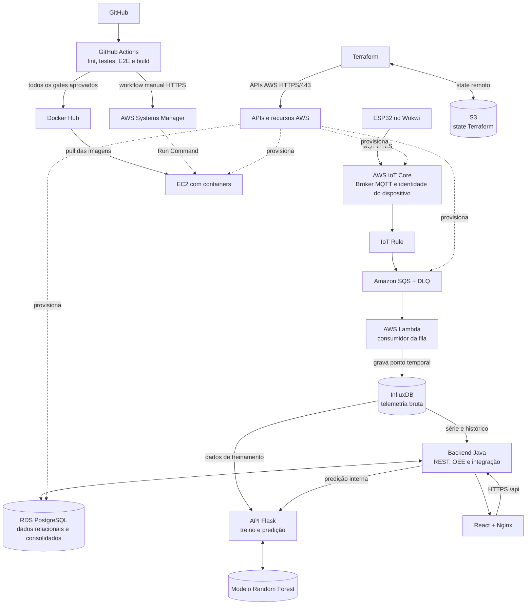

# Aula 1 — Visão geral integradora + ESP32/MQTT

## Propósito

Como a turma chega ao final do semestre tendo estudado as disciplinas em separado, esta aula começa pelo problema completo e mostra onde cada conhecimento se encaixa. MQTT e Node-RED são retomados como base conhecida. A aula não recomeça o estudo de MQTT do zero: ela acompanha uma mensagem do Wokwi e mostra o que muda quando o broker, as filas, o processamento e a aplicação ficam na nuvem.

## Objetivos

Ao final, o aluno deve conseguir:

1. Relacionar automação, ciência de dados, cloud e DevOps no mesmo sistema.
2. Explicar o caminho de uma leitura ESP32 → IoT Core → SQS → Lambda → InfluxDB.
3. Distinguir InfluxDB, RDS PostgreSQL, backend Java, serviço Flask e frontend React.
4. Explicar por que o frontend chama somente a API Java.
5. Separar criação da infraestrutura, publicação das imagens e deploy na EC2.
6. Identificar os conceitos novos que serão aprofundados nas aulas seguintes.

## Ponto de partida: conhecimentos já trabalhados

Comece perguntando o que a turma já sabe e registrando as respostas:

- **Sensores/ESP32:** leitura de sinais e envio de dados.
- **MQTT:** broker, tópico, publicação e assinatura.
- **Node-RED em Docker:** montagem visual de fluxos e integração de nós.
- **Nuvem pela interface gráfica:** criação de EC2 e contato com Kubernetes.
- **Docker:** execução de serviços em containers.

Explique que o projeto preserva esse conhecimento e muda a pergunta: como conectar as disciplinas e automatizar os caminhos entre serviços?

## Arquitetura integrada



## Um passeio por uma mensagem

Abra o Wokwi e escolha uma mensagem real publicada pela simulação. Use um exemplo como referência:

```json
{
  "device_id": "esp32-torno-01",
  "machine_type": "USINAGEM",
  "timestamp": 1794187962,
  "temperatura": 54.91,
  "vibracao": 2.18,
  "rpm": 3100,
  "machine_state": "RUNNING",
  "pecas_produzidas": 23,
  "pecas_defeito": 1
}
```

Pergunte à turma, em cada etapa, qual serviço recebe a mensagem e qual responsabilidade assume:

1. O **ESP32** converte entradas analógicas em valores e publica JSON.
2. O **MQTT** transporta a publicação por um tópico conhecido.
3. O **AWS IoT Core** autentica o dispositivo e recebe a mensagem pela conexão TLS.
4. Uma **IoT Rule** seleciona o tópico e encaminha a mensagem para a **SQS**.
5. A **Lambda** consome a fila, valida e transforma o payload em ponto do InfluxDB.
6. O **InfluxDB** mantém a série temporal bruta.
7. O **Java** consulta os dados, mantém regras da aplicação e cria consolidações no RDS.
8. O **Flask** usa o histórico para treinar/predizer; o Java intermedeia a chamada.
9. O **React** apresenta os resultados chamando a API Java.

## Da experiência MQTT/Node-RED para IoT Core

| O que a turma já conhece | Como aparece no projeto | Conceito adicional |
|---|---|---|
| Broker MQTT no laboratório | AWS IoT Core | Broker gerenciado, endpoint da conta, certificado de dispositivo e IoT Policy. |
| Tópico e mensagem | `industria/smartn1/telemetria` | IoT Rule que reage ao tópico sem um fluxo Node-RED permanentemente ligado. |
| Fluxo/encaminhamento no Node-RED | IoT Rule → SQS → Lambda | Fila durável, retentativa, DLQ e consumidor serverless. |
| Node-RED em container | Serviços empacotados em Docker | Serviços cloud gerenciados não são containers que os alunos administram. |

Node-RED foi importante para aprender MQTT e prototipar fluxos. Nesta arquitetura ele não é o consumidor cloud: a regra do IoT Core e a Lambda assumem esse papel no caminho de produção didático.

## Serviços conectados por responsabilidade

| Serviço | Analogia didática | Responsabilidade aqui |
|---|---|---|
| IoT Core | Broker MQTT da disciplina | Identidade do dispositivo, conexão TLS e recebimento de tópico. |
| IoT Rule | Regra de encaminhamento | Seleciona mensagens e direciona a fila. |
| SQS | Buffer entre produtores e consumidores | Absorve variações de ritmo e permite repetição de processamento. |
| DLQ | Área de mensagens para investigação | Guarda mensagens que excedem as tentativas configuradas. |
| Lambda | Função executada sob demanda | Consome a fila, valida e grava a leitura. |
| InfluxDB | Banco especializado em séries temporais | Mantém leituras com timestamp para histórico e gráficos. |
| RDS PostgreSQL | Banco relacional gerenciado | Cadastro, alertas e consolidações consultadas pelo backend. |
| Java | API de negócio | Controla contratos REST, integra dados, OEE e chamadas para ML. |
| Flask | API de modelo | Prepara dados, treina Random Forest e fornece predição ao Java. |
| React/Nginx | Interface web | Mostra os dados e encaminha `/api` à API Java. |
| GitHub Actions | Robô de validação/entrega | Executa gates e, em workflows manuais, publica/deploya. |
| Terraform | Descrição executável da infraestrutura | Provisiona recursos AWS por APIs, com state no S3. |

## Três fluxos de aplicação e um de entrega

### Telemetria

`ESP32 → IoT Core → IoT Rule → SQS → Lambda → InfluxDB`.

### Uso dos dados e modelo

`React → Java → (InfluxDB/RDS)` para consulta; `React → Java → Flask → Java → React` para treino e predição. O Java é a única API chamada pelo navegador.

### Infraestrutura

`GitHub Actions → Terraform → APIs AWS` usando HTTPS/443 e state remoto no S3. Provisionar não publica containers.

### Imagens e deploy

`GitHub → quality gates → Docker Hub → EC2`; o envio de comando para a EC2 ocorre separadamente via `GitHub Actions → SSM Run Command → EC2`. Publicação e deploy são manuais e distintos.

## Conceitos novos que terão mais tempo nas próximas aulas

1. **AWS IoT Core:** identidade/certificado, policy, endpoint, regra IoT e SQL da regra.
2. **SQS e Lambda:** processamento assíncrono, batches, tentativas, DLQ, partial batch failure e logs.
3. **Terraform:** HCL, recursos, variáveis, dependências, plano, apply e state remoto; diferença para criar EC2/Kubernetes por interface.
4. **Docker Hub e GitHub Actions:** imagem/tag, registry, workflow reutilizável, quality gates e aprovação manual.
5. **SSM:** executar deploy sem abrir SSH, com conexão de saída HTTPS da EC2.

## Roteiro de aula e atividade

1. **Ativar conhecimentos prévios:** desenhar no quadro o fluxo MQTT/Node-RED já conhecido.
2. **Apresentar o problema industrial:** qual sinal indica a condição da máquina? Como uma equipe usaria o histórico?
3. **Demonstrar o Wokwi:** selecionar uma mensagem e mapear `device_id`, timestamp, sensores e contadores.
4. **Seguir a arquitetura:** mover um cartão “mensagem” do ESP32 até o painel, nomeando a responsabilidade de cada serviço.
5. **Comparar processos:** distinguir dado bruto, consolidação e predição.
6. **Comparar deploy e provisionamento:** colocar Terraform, Docker Hub e SSM em setas diferentes.
7. **Fechar com previsão das próximas aulas:** apresentar os cinco conceitos novos e o produto esperado ao final do curso.

### Trabalho em grupo

Distribua cartões “ESP32”, “MQTT/Node-RED”, “IoT Core”, “SQS”, “Lambda”, “InfluxDB”, “RDS”, “Java”, “Flask”, “React”, “Terraform”, “Docker Hub”, “GitHub Actions”, “SSM” e “EC2”. Os grupos devem montar quatro caminhos: telemetria, predição, provisionamento e deploy. Peça que diferenciem o conhecimento já familiar dos elementos novos.

## Evidência de aprendizagem

Cada grupo deve explicar, sem ler o diagrama:

- qual é a primeira mudança entre o broker MQTT do laboratório e AWS IoT Core;
- por que existe SQS entre a regra IoT e a Lambda;
- onde ficam leituras brutas e onde ficam consolidações;
- por que o navegador usa Java em vez de chamar Flask ou um banco;
- por que Terraform, publicação no Docker Hub e deploy SSM são ações separadas.

## Preparação para a aula 2

Revisar conceitos MQTT conhecidos: tópico, publish/subscribe e payload. Ler as seções de ingestão e contrato MQTT em [`docs/05_contratos_e_especificacoes.md`](../docs/05_contratos_e_especificacoes.md). Não é necessário decorar IAM ou sintaxe de regra IoT antes da aula; esses pontos serão trabalhados passo a passo.

## Referências

- [Guia do ESP32/Wokwi](../docs/07_guia_esp32_wokwi.md)
- [Contratos de dados](../docs/05_contratos_e_especificacoes.md)
- [Visão geral completa](../README.md)
