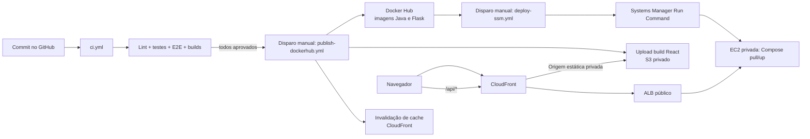

# Aula 7 — Docker Hub e deploy por GitHub Actions

## Contexto

Os alunos já estudaram Docker; esta aula mostra a passagem do container local para imagens versionadas, um registry e um servidor remoto. O tema novo é o fluxo de entrega controlada: GitHub Actions verifica a alteração, publica as imagens Java/Flask no Docker Hub, compila o React para arquivos estáticos no S3 e Systems Manager executa o deploy dos serviços backend na EC2 privada sem abrir SSH.

## Objetivos

- Diferenciar Dockerfile, imagem, container e registry.
- Explicar tags `latest` e `sha-<commit>` e usar a tag imutável no deploy.
- Ler jobs e steps de um workflow GitHub Actions.
- Entender lint, testes, E2E e build de container como gates.
- Explicar por que publicar e fazer deploy são etapas manuais separadas.
- Descrever SSM Run Command e atualização por Docker Compose na EC2.

## Conceitos a ensinar explicitamente

### Dockerfile versus Docker Hub

- **Dockerfile:** instruções para construir uma imagem.
- **Imagem:** artefato imutável que empacota aplicação e dependências.
- **Container:** processo em execução a partir de uma imagem.
- **Docker Hub:** registry remoto que armazena imagens e tags para download.

Um `docker build` local não publica nada. Um push envia uma imagem ao registry. A EC2 faz pull das imagens Java e Flask antes de iniciar ou atualizar os containers. O frontend não é enviado como container na AWS: o workflow publica o build estático no bucket S3 privado e invalida o cache CloudFront.

### Tags e rastreabilidade

- `latest` é uma referência mutável útil para consulta rápida no registry.
- `sha-<commit>` aponta para uma versão ligada a um commit do Git e facilita auditoria e rollback.
- O workflow de deploy exige o SHA completo e instala essa versão; não usa `latest`.

O tag é identificação, não mecanismo de segurança por si só. Segredos do Docker Hub devem ficar em GitHub Secrets.

### GitHub Actions

Um workflow é um arquivo YAML com eventos, permissões, jobs e steps. Jobs podem rodar em runners distintos. O workflow reutilizável de quality gates evita duplicar a mesma suíte entre CI e publicação.

No projeto, os gates incluem Ruff, ESLint, testes Python/Java/React/Lambda, build React, E2E e builds Docker com `push: false`. Um job de publicação depende de todos os quality gates. Falha em um gate impede o job `publish`.

### Publicação não é deploy

1. **CI:** analisa código e executa verificações.
2. **Build/publish:** constrói imagens e, se os gates passarem, as envia ao Docker Hub.
3. **Provisionamento:** Terraform cria/atualiza infraestrutura AWS.
4. **Deploy:** SSM pede à EC2 para baixar imagens e executar Compose.

Estas etapas são separadas para que uma alteração de aplicação não crie recursos de nuvem inadvertidamente, e um provisionamento não publique uma imagem automaticamente.

## Fluxo praticado neste repositório

O workflow `ci.yml` valida alterações em PRs e pushes. O workflow `publish-dockerhub.yml` é manual e seleciona a branch `main`. Ele chama os mesmos gates antes de iniciar o login e push. O workflow `deploy-ssm.yml` é disparado separadamente e pede o SHA completo publicado para instalar as imagens e a configuração correspondentes.

## Por que SSM em vez de SSH

No modelo SSH, o runner inicia conexão para a porta 22 e precisa de chave/rota. Neste projeto, GitHub Actions usa APIs AWS por HTTPS para pedir um Run Command. O SSM Agent da EC2 mantém comunicação de saída HTTPS e executa o comando. A instância baixa imagens do Docker Hub e roda `docker compose pull` e `docker compose up -d`.

Isso não significa que o SSM ignora permissões: a EC2 precisa de instance profile adequado e alcançabilidade aos endpoints SSM. O runner também precisa de credenciais AWS válidas e permissão para enviar/consultar Run Command.

## Roteiro de laboratório

1. Abrir `frontend-react/Dockerfile`, `backend-java/Dockerfile` e `ml-service/Dockerfile`; identificar etapas e dependências.
2. Relacionar cada imagem a seu serviço no `docker-compose.cloud.yml`.
3. Abrir `quality-gates.yml`; cada grupo explica um job e qual falha deve bloquear publicação.
4. Abrir `publish-dockerhub.yml`; localizar o `needs: quality-gates`, login, contexto Docker e tags.
5. Copiar o SHA do commit publicado e informá-lo no workflow manual de deploy.
6. Abrir `deploy-ssm.yml`; localizar envio de comando, parâmetros de runtime e consulta do estado SSM.
7. Apresentar o build React sendo servido pelo CloudFront/S3 e a EC2 privada baixando apenas as imagens Java/Flask, sem conexão SSH de entrada.

## Atividade

Entregue três cartões de incidente:

- “lint falhou”;
- “imagem publicada, mas versão antiga continua na EC2”;
- “SSM não encontra instância online”.

Os grupos devem indicar qual workflow/log consultar e em qual fase investigar. O primeiro incidente bloqueia o publish; o segundo requer verificar tag, pull e restart do Compose; o terceiro exige verificar alvo, SSM Agent, instance profile e rede de saída.

## Evidência de aprendizagem

O aluno desenha a alteração desde o commit até o container atualizado e responde:

- Em que ponto a imagem passa a existir no Docker Hub?
- Que relação existe entre o tag SHA e o commit?
- O que impede o push se o teste E2E falhar?
- Quem executa o comando de deploy na EC2?
- Terraform participa do deploy desta aplicação?

## Tarefa

Escolher um workflow e descrever evento de disparo, secrets necessários, ações externas e condição de falha. Nunca copiar o valor dos secrets para o relatório.

## Referências

- [Guia DevOps/CI/CD](../docs/04_devops_ci_cd.md)
- [Workflow de CI](../.github/workflows/ci.yml)
- [Quality gates](../.github/workflows/quality-gates.yml)
- [Publicação Docker Hub](../.github/workflows/publish-dockerhub.yml)
- [Deploy SSM](../.github/workflows/deploy-ssm.yml)
- [Compose da nuvem](../docker-compose.cloud.yml)
